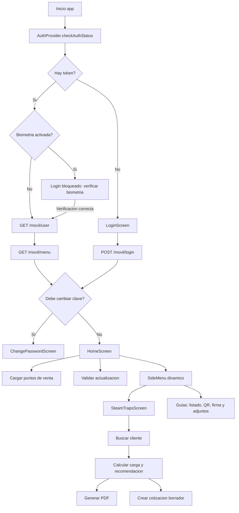

# Guia de desarrollador - TUVAL App Movil

Revisada contra el codigo local el 18 de noviembre de 2026. Esta guia Markdown es la referencia de mantenimiento. Los Word/PDF de `docs/` son exportaciones anteriores y no se regeneran automaticamente.

## Proposito del documento

Este documento describe la estructura del proyecto Flutter `tuvalapp`, sus flujos principales y los puntos que un nuevo desarrollador debe conocer para entender, mantener y extender el sistema.

La aplicacion es una app movil Flutter para TUVAL. Cubre autenticacion con biometria opcional, seleccion de punto de venta, menu dinamico, guias de remision con QR, firmas y adjuntos, actualizaciones y dimensionamiento de trampas de vapor con PDF y cotizaciones borrador.

## Resumen tecnico

- Framework: Flutter.
- Lenguaje: Dart.
- Flutter usado por CI QA: `3.44.1` stable, segun `.github/workflows/deploy-qa.yml`. `.metadata` registra revisiones del proyecto, no la version del SDK local.
- SDK Dart requerido: `^3.11.5`, segun `pubspec.yaml`.
- SDK requerido por las dependencias bloqueadas: Dart `>=3.12.0 <4.0.0` y Flutter `>=3.44.0`, segun `pubspec.lock`.
- Version base: `1.0.17+2018`, segun `pubspec.yaml`. CI QA sustituye nombre y numero de build; este archivo no determina la version instalada.
- Estado global: `provider`.
- Cliente HTTP: `dio`.
- Persistencia local segura: `flutter_secure_storage`.
- Version de paquete/plataforma: `package_info_plus`.
- Apertura de URLs externas: `url_launcher`.

## Estructura general

```text
.
|-- android/                Configuracion nativa Android, sabores y signing
|-- assets/                 Imagenes y recursos visuales de la app
|-- ios/                    Proyecto nativo iOS
|-- lib/                    Codigo principal Dart/Flutter
|   |-- config/             Ambiente, rutas, tema y cliente HTTP
|   |-- domain/             Entidades, contratos y repositorios de dominio
|   |-- infrastructure/     Datasources, modelos y servicios concretos
|   `-- presentation/       Providers, pantallas y widgets UI
|-- linux/                  Proyecto nativo Linux generado por Flutter
|-- macos/                  Proyecto nativo macOS generado por Flutter
|-- test/                   Tests Flutter
|-- web/                    Proyecto web generado por Flutter
|-- windows/                Proyecto nativo Windows generado por Flutter
|-- pubspec.yaml            Dependencias, assets, version y SDK Dart
`-- pubspec.lock            Resolucion exacta de dependencias
```

La estructura de `lib/` sigue una separacion por capas:

- `config`: piezas transversales de configuracion.
- `domain`: definiciones de negocio y contratos.
- `infrastructure`: implementaciones concretas contra APIs, modelos JSON y servicios.
- `presentation`: estado de UI, pantallas, widgets y helpers visuales.

## Arranque de la aplicacion

Archivo principal: `lib/main.dart`.

El metodo `main()` inicializa Flutter, crea una instancia compartida de `KeyValueStorageService` y registra providers globales:

- `AuthProvider`: controla autenticacion, usuario actual, menu y cambio obligatorio de clave.
- `PointSalesProvider`: controla puntos de venta disponibles y punto de venta seleccionado.

La raiz de UI es `MyApp`, que construye un `MaterialApp` con:

- Tema global desde `AppTheme`.
- Rutas desde `AppRouter`.
- Pantalla inicial determinada por `AuthStatus`.
- Banner inferior de ambiente cuando no es produccion.

El flujo de pantalla inicial depende de `AuthProvider.authStatus`:

```text
checking             -> CheckAuthScreen
notAuthenticated     -> LoginScreen
mustChangePassword   -> ChangePasswordScreen
authenticated        -> HomeScreen
```

## Ambientes

Archivo: `lib/config/environment/app_environment.dart`.

El ambiente se define con `--dart-define=APP_ENV=<env>`.

Ambientes soportados:

| APP_ENV | API base |
| --- | --- |
| `dev` | `http://172.16.1.110:8000/api` |
| `qa` | `http://tuvalapi.cosenco.ec/api` |
| `prod` | `https://api.tuvalsa.com/api` |

Si no se especifica `APP_ENV`, el valor por defecto es `dev`.

En produccion se desactivan los logs HTTP y no se muestra el banner de ambiente. En `dev` y `qa`, solo en debug, `DioClient` registra codigo HTTP y tipo de error. No registra URLs, consultas, cabeceras, cuerpos ni excepciones completas. QA mantiene HTTP en la red cerrada de pruebas.

## Rutas

Archivo: `lib/config/router/app_router.dart`.

Rutas registradas:

| Ruta | Pantalla | Uso |
| --- | --- | --- |
| `login` | `LoginScreen` | Login manual |
| `home` | `HomeScreen` | Pantalla principal |
| `/steam-traps` | `SteamTrapsScreen` | Modulo de trampas de vapor |
| `/inventory/delivery-notes` | `DeliveryNotesScreen` | Guias, QR, firmas y adjuntos |
| `/reports/sales/branch-sales` | `BranchSalesScreen` | Reportes → Listado de ventas por sucursal |

El menu del backend no navega directo con estas rutas. Primero pasa por `MobileMenuMapper`, que traduce rutas logicas del backend a rutas Flutter.

Archivo: `lib/presentation/shared/helpers/mobile_menu_mapper.dart`.

Mapeo actual:

| Ruta backend | Ruta Flutter |
| --- | --- |
| `app.home` | `Navigator.defaultRouteName` |
| `app.equipment.steam_traps.index` | `/steam-traps` |
| `app.inventory.delivery_notes.index` | `/inventory/delivery-notes` |
| `app.sales.branch_sales.index` | `/reports/sales/branch-sales` |

Para agregar una nueva opcion de menu movil, normalmente se debe:

1. Crear la pantalla.
2. Registrar la ruta en `AppRouter`.
3. Agregar el mapeo en `MobileMenuMapper.resolveRoute`.
4. Asegurar que el backend envie esa ruta en `/movil/menu`.

## HTTP y manejo de errores

### Cliente HTTP

Archivo: `lib/config/http/dio_client.dart`.

`main()` inyecta un cliente compartido creado por `DioClient.create()`. `DioClient.instance` queda como respaldo para constructores sin inyeccion y no incluye por si solo el callback de expiracion de la app. El cliente centraliza:

- `baseUrl` segun `AppEnvironment.apiBaseUrl`.
- Timeouts de conexion y recepcion de 15 segundos.
- Headers `Accept` y `Content-Type` en JSON.
- Inyeccion automatica de token Bearer desde `flutter_secure_storage`.
- Logs de metadatos de respuesta en debug no productivo.
- Ante HTTP 401 de una solicitud autenticada con Bearer, llama a `AuthProvider.expireSession()`. Solo cierra la sesion si el token rechazado sigue siendo el actual. Un 401 de login publico o un 403 de una operacion no dispara esta limpieza global.

Por defecto, toda solicitud requiere autenticacion. Para llamadas publicas se usa:

```dart
Options(extra: {'requiresAuth': false})
```

### Handler de API

Archivo: `lib/config/http/api_handler.dart`.

`ApiHandler.run()` estandariza las respuestas:

- Convierte respuestas `Map` o `String` JSON a `Map<String, dynamic>`.
- Espera que la respuesta tenga `success: true`.
- Si `success` no es verdadero, lanza `ApiException`.
- Traduce errores de red y validacion a mensajes legibles.

Contrato esperado por el frontend:

```json
{
  "success": true,
  "message": "Operacion completada",
  "data": {}
}
```

Si el backend devuelve `errors`, se toma el primer error de validacion como mensaje principal.

### Excepcion API

Archivo: `lib/config/http/api_exception.dart`.

`ApiException` contiene:

- `message`
- `status`
- `data`
- `errors`

Los providers usan `message` para mostrar errores al usuario.

## Endpoints usados

Los endpoints estan en `lib/config/http/endpoints/`.

| Archivo | Endpoint | Uso |
| --- | --- | --- |
| `auth_endpoints.dart` | `/movil/login` | Login |
| `auth_endpoints.dart` | `/movil/user` | Usuario autenticado |
| `auth_endpoints.dart` | `/movil/menu` | Menu movil |
| `auth_endpoints.dart` | `/movil/change-password` | Cambio de clave |
| `auth_endpoints.dart` | `/movil/point-sales` | Puntos de venta |
| `customers_endpoints.dart` | `/movil/cliente/buscar` | Busqueda de clientes |
| `app_version_endpoints.dart` | `/movil/app/latest` | Ultima version disponible |
| `steam_trap_endpoints.dart` | `/movil/trampas-vapor/dimensionamiento` | Generar PDF tecnico |
| `steam_trap_endpoints.dart` | `/movil/trampas-vapor/borrador` | Crear cotizacion borrador |
| `article_endpoints.dart` | `/movil/articulos/trampas-vapor/dimensionamiento` | Endpoint definido, no usado actualmente en el flujo leido |

## Autenticacion

Archivos principales:

- `lib/presentation/providers/auth_provider.dart`
- `lib/infrastructure/datasources/sanctum_datasource.dart`
- `lib/presentation/screens/auth/login_screen.dart`
- `lib/presentation/screens/auth/change_password_screen.dart`
- `lib/presentation/screens/auth/check_auth_screen.dart`

### Flujo de login

1. `LoginScreen` valida usuario y clave.
2. `AuthProvider.login()` llama a `SanctumDatasource.login()`.
3. El datasource envia `POST /movil/login` sin token.
4. El backend debe devolver usuario, token y menu.
5. `UserModel` normaliza el JSON del usuario.
6. `LoginResponseModel` extrae usuario, token y `AppMenu`.
7. El token se guarda como `auth_token` en `flutter_secure_storage`.
8. El estado pasa a:
   - `mustChangePassword`, si `user.mustChangePassword` es verdadero.
   - `authenticated`, si el usuario puede continuar.

Tambien se valida `appAccess`. Si el backend indica que el usuario no tiene acceso movil, se lanza error 403 con mensaje funcional.

### Restauracion de sesion

Al crear `AuthProvider`, se ejecuta `checkAuthStatus()`:

1. Busca `auth_token` en almacenamiento seguro.
2. Si no existe, marca `notAuthenticated`.
3. Si existe y la biometria esta activada, mantiene bloqueada la sesion hasta verificarla. En caso contrario consulta `/movil/user` y `/movil/menu`.
4. Si las llamadas son validas, restaura usuario y menu.
5. Ante 401/403 durante la restauracion cierra la sesion. Otros fallos bloquean la UI con un mensaje y conservan el token. Una respuesta de una sesion invalidada no puede restaurar al usuario.

### Biometria

`BiometricAuthService` usa `local_auth` en Android/iOS. La opcion se activa desde el menu lateral con verificacion del sistema y se guarda como `biometric_enabled`. No almacena datos biometricos ni contrasenas. Con la opcion activa, el token permanece guardado pero la app inicia bloqueada hasta verificar la biometria. Se permite usar credenciales si no esta disponible. Un nuevo login por contrasena y el logout eliminan la preferencia anterior.

### Cambio obligatorio de clave

Si el usuario tiene `mustChangePassword`, la app muestra `ChangePasswordScreen`.

La pantalla:

- Solicita nueva clave.
- Valida minimo 8 caracteres.
- Llama a `POST /movil/change-password`.
- Al completar, marca al usuario como autenticado con `mustChangePassword: false`.

### Logout

`AuthProvider.logout()` invalida inmediatamente la sesion en memoria, limpia usuario/menu y vuelve a `notAuthenticated`. El callback comun `onSessionEnded` limpia puntos de venta en cualquier via de cierre, incluida la expiracion HTTP. Tambien se ejecuta antes de activar un nuevo login por contrasena.

Las escrituras del token y la biometria se serializan con su limpieza. No se permite otro login mientras termina el cierre. La clave de `MaterialApp` depende de `AuthStatus`; al cambiar el estado se retiran rutas y dialogos anteriores.

`PointSalesProvider` se registra antes de `AuthProvider`, cuyo callback lo utiliza. El callback HTTP referencia al `AuthProvider` creado por la app; no se debe buscar un provider descendiente desde el contexto de creacion de `Dio`.

## Menu y pantalla principal

Archivos principales:

- `lib/presentation/screens/home/home_screen.dart`
- `lib/presentation/screens/home/widgets/side_menu.dart`
- `lib/presentation/screens/home/widgets/content_body.dart`
- `lib/infrastructure/models/menu/app_menu_model.dart`

`HomeScreen` hace dos tareas al entrar:

1. Carga puntos de venta con `PointSalesProvider.loadPointSales()`.
2. Verifica si hay actualizacion disponible con `AppUpdateService.checkForUpdate()`.

La pantalla principal muestra una tarjeta de bienvenida con el nombre del usuario.

El `SideMenu` se construye con `authProvider.appMenu.items`, que viene del backend.

El reporte de ventas se organiza en **Reportes → Listado de ventas por sucursal** mediante `MobileMenuMapper.organizeReports`. Esta adaptación solo agrupa la opción si el backend ya la concedió; reutiliza Reportes si existe y conserva el identificador lógico `app.sales.branch_sales.index` y sus permisos. La presentación y provider están en `screens/reports/sales/branch_sales/`. La ruta Flutter antigua `/sales/branch-sales` se conserva como alias. Las nuevas opciones deben registrarse con su jerarquía en el backend, no añadirse como accesos locales.

Soporta:

- Items simples.
- Items con hijos mediante `ExpansionTile`.
- Estado activo segun la ruta actual.
- Logout seguro.

Si una ruta del backend no esta mapeada en `MobileMenuMapper`, se muestra un mensaje: `Ruta no configurada`.

## Puntos de venta

Archivos principales:

- `lib/presentation/providers/point_sales_provider.dart`
- `lib/infrastructure/datasources/point_sales_datasource.dart`
- `lib/infrastructure/models/point_sales/point_sales_response.dart`
- `lib/infrastructure/models/point_sales/point_sale_model.dart`
- `lib/presentation/shared/widgets/current_point_sale_badge.dart`

`PointSalesProvider` carga la lista desde `GET /movil/point-sales`.

El backend debe devolver dentro de `data`:

```json
{
  "pv_default": 1,
  "pv_list": [
    {
      "pv_id": 1,
      "pv_code": "001",
      "pv_descripcion": "Matriz",
      "is_default": true
    }
  ]
}
```

Seleccion inicial:

1. Intenta usar el punto guardado en `selected_point_sale_id`.
2. Si no existe, usa el item con `is_default`.
3. Si no existe, usa `pv_default`.
4. Si no existe, usa el primer punto de venta de la lista.

El punto de venta activo se muestra en `TuvalAppBar` mediante `CurrentPointSaleBadge`.

`clearPointSales()` invalida las cargas pendientes mediante una generacion y limpia el estado inmediatamente. Las escrituras de `selected_point_sale_id` se serializan con el borrado para impedir que una escritura anterior sobreviva al cierre.

El modulo de trampas de vapor requiere un punto de venta seleccionado para generar PDF o cotizacion.

## Actualizaciones de app

Archivos principales:

- `lib/infrastructure/services/app_update_service.dart`
- `lib/infrastructure/datasources/app_version_datasource.dart`
- `lib/domain/entities/app_version_info.dart`
- `lib/presentation/widgets/app_update_dialog.dart`

`HomeScreen` llama `AppUpdateService.checkForUpdate()`.

Reglas:

- En `dev` o `kDebugMode`, no revisa actualizaciones.
- En ambientes no debug, consulta `GET /movil/app/latest?platform=android`.
- Compara `PackageInfo.buildNumber` contra:
  - `latest_build`
  - `minimum_required_build`

Si `currentBuild < latestBuild`, hay actualizacion.

Si `currentBuild < minimumRequiredBuild`, la actualizacion es obligatoria y el dialogo no permite cerrarse.

Contrato esperado:

```json
{
  "platform": "android",
  "latest_version": "1.0.1",
  "latest_build": 2,
  "minimum_required_build": 1,
  "apk_url": "https://...",
  "message": "Nueva version disponible",
  "release_notes": "Cambios principales",
  "checksum_sha256": "...",
  "apk_size_bytes": 12345678
}
```

## Modulo: trampas de vapor

Modulo tecnico para calculo y generacion de documentos.

Archivos principales:

- `lib/presentation/screens/equipment/steam_traps/steam_traps_screen.dart`
- `lib/presentation/screens/equipment/steam_traps/providers/steam_trap_provider.dart`
- `lib/presentation/screens/equipment/steam_traps/helpers/steam_trap_calculator.dart`
- `lib/presentation/screens/equipment/steam_traps/constants/steam_traps_catalogs.dart`
- `lib/infrastructure/datasources/steam_trap_datasource.dart`
- `lib/infrastructure/datasources/customers_datasource.dart`
- `lib/infrastructure/models/steam_traps/steam_trap_sizing_request.dart`
- `lib/infrastructure/models/steam_traps/steam_trap_customer.dart`

### Objetivo funcional

Permite seleccionar un cliente, ingresar datos tecnicos del proceso, calcular una carga estimada de condensado, recomendar un tipo de trampa de vapor y enviar el resultado al backend para:

- Generar un PDF tecnico.
- Crear una cotizacion borrador.

### Pantalla

`SteamTrapsScreen` crea un `SteamTrapProvider` local a la pantalla y renderiza:

1. `CustomerSearchCard`: busqueda y seleccion de cliente.
2. Selector de proceso/aplicacion.
3. `PressureCard`: presion de trabajo y retorno.
4. `CalculationCard`: campos dinamicos segun tipo de proceso.
5. `RecommendationCard`: resumen, validacion, calculos y acciones.

### Busqueda de clientes

`CustomerSearchCard` usa `CustomerSearchController`, disponible en `SteamTrapProvider.customerSearch` y compartido con el listado de guias. Descarta resultados de busquedas anteriores y cancela el debounce al destruirse.

Reglas:

- Limpia resultados cuando cambia el texto.
- Requiere minimo 3 caracteres.
- Usa debounce de 450 ms.
- Llama a `CustomersDatasource.searchCustomers()`.

El datasource envia:

```json
{
  "search": "texto",
  "tipo": "proceso"
}
```

a `POST /movil/cliente/buscar`.

El modelo `SteamTrapCustomer` espera campos:

- `id`
- `CLI_RUC`
- `CLI_RAZON_SOCIAL`
- `CLI_NOMBRE_CORTO`
- `CLI_CIUDAD`
- `CLI_PROVINCIA`

Solo se conservan resultados con `id > 0`, RUC no vacio y razon social no vacia.

### Catalogos tecnicos

Archivo: `steam_traps_catalogs.dart`.

Procesos de calentamiento:

- `Marmita`
- `Intercambiador (placas/tubos)`
- `Rotatubos`
- `Rotadiscos`
- `Peletizadora`
- `Extrusora`
- `Autoclave`

Procesos de drenaje/arrastre:

- `Bota de condensado`
- `Separador de humedad`
- `Distribuidor`
- `Final de linea`
- `Traceo`

Fluidos:

- `Agua`: Cp 4.19, densidad 1000.
- `Agua salada`: Cp 4.00, densidad 1028.
- `Aceite`: Cp 2.30, densidad 900.
- `Bunker`: Cp 2.09, densidad 950.

Tambien contiene una tabla de `hfg` para presiones de 5 a 250 PSIG.

### Conversion de presion

Archivo: `steam_trap_calculator.dart`.

`pressureToPsig()` soporta conversion desde:

- `psig`
- `barg`
- `kpag`
- `psia`
- `bara`
- `kpaa`

Nota: la UI actual muestra la unidad fija `PSIG` en `PressureCard`, aunque el provider conserva `selectedUnd` y metodos para otras unidades.

### Ruta de calculo: calentamiento indirecto

Aplica cuando el proceso esta en `heatingProcesses`.

Campos usados:

- Fluido.
- Volumen en m3.
- Temperatura inicial.
- Temperatura final.
- Tiempo en minutos.
- Presion de trabajo.
- Presion de retorno.

Calculos:

```text
masaKg = densidad * volumen
deltaT = tempFinal - tempInicial
calorRequeridoKj = masaKg * Cp * deltaT
cargaEstimada = (60 * densidad * volumen * Cp * deltaT) / (hfg * tiempoMin)
cargaConFs = cargaEstimada * 1.5
```

`hfg` se obtiene por interpolacion lineal desde la tabla PSIG.

Recomendacion actual:

```text
Calentamiento -> Flotador
```

### Ruta de calculo: drenaje / arrastre

Aplica cuando el proceso esta en `drainProcesses`.

Campos usados:

- Carga conocida del punto, si existe.
- Capacidad de caldera en BHP, si no se conoce la carga.
- Presion de trabajo.
- Presion de retorno.

Calculos:

```text
si carga conocida > 0:
  cargaEstimada = carga conocida
si no:
  cargaEstimada = 0.15 * BHP * 15.65
cargaConFs = cargaEstimada * 1.5
```

Recomendacion actual:

```text
Traceo -> Termodinamica
Drenaje con presion > 250 y <= 600 PSIG -> Termodinamica
Drenaje con presion <= 250 PSIG -> Balde invertido
Otro caso -> Revisar condicion tecnica
```

### Validaciones principales

Antes de generar PDF o cotizacion:

- Los campos numericos usan `DecimalInput`: solo decimales finitos con punto o coma y signo negativo opcional. Se rechazan textos, `NaN`, infinitos, notacion cientifica y separadores mezclados. La UI rechaza la edicion completa si es invalida, sin extraer digitos de un texto pegado.
- Presiones, volumen, temperaturas y tiempo son obligatorios cuando corresponden al proceso activo. En drenaje, carga conocida y BHP admiten vacio como alternativas, pero cualquier valor escrito debe ser numerico.
- El provider valida tambien al construir el payload; no convierte texto invalido en cero. Si los calculos desbordan a valores no finitos, bloquea el envio.
- Debe existir cliente seleccionado.
- La presion de trabajo debe ser mayor a 0.
- La presion de retorno no puede ser negativa.
- La presion de retorno debe ser menor que la presion de trabajo.
- En calentamiento, la presion debe estar entre 5 y 250 PSIG.
- En drenaje, presiones mayores a 600 PSIG requieren revision tecnica.
- En calentamiento, volumen y tiempo deben ser mayores a 0.
- En calentamiento, temperatura final debe ser mayor que inicial.
- En drenaje, se requiere carga conocida o BHP.

### Payload enviado al backend

`SteamTrapSizingRequest.toJson()` arma el payload para PDF y cotizacion:

```json
{
  "customer_id": 1,
  "customer_ruc": "0999999999001",
  "pvId": 1,
  "pvDescription": "Matriz",
  "pvCode": "001",
  "process": "Marmita",
  "trapType": "Flotador",
  "calculationMethod": "Energia / calentamiento indirecto",
  "workingPressurePsig": 5,
  "returnPressurePsig": 0,
  "pressureDifferentialPsig": 5,
  "fluid": "Agua",
  "volumeM3": 0.1,
  "densityKgM3": 1000,
  "cpKjKgC": 4.19,
  "initialTemperatureC": 20,
  "finalTemperatureC": 90,
  "heatingTimeMin": 30,
  "requiredHeatKj": 29330,
  "hfgKjKg": 2234.1,
  "knownLoadKgH": null,
  "boilerBhp": null,
  "estimatedLoadKg": 26.26,
  "safetyFactor": 1.5,
  "loadWithSafetyFactorKg": 39.39,
  "spParams": {
    "workingPressurePsig": 5,
    "returnPressurePsig": 0,
    "estimatedLoadKg": 26.26,
    "safetyFactor": 1.5
  }
}
```

Las claves `knownLoadKgH` y `boilerBhp` se incluyen con valor `null` cuando no aplican; sus valores se calculan para la ruta de drenaje correspondiente.

### Acciones del modulo

En `RecommendationCard` hay dos acciones:

#### Generar PDF tecnico

1. Valida cliente y datos tecnicos.
2. Toma punto de venta actual desde `PointSalesProvider`.
3. Construye `SteamTrapSizingRequest`.
4. Envia `POST /movil/trampas-vapor/dimensionamiento`.
5. Espera `data.pdfUrl`.
6. Si existe URL, habilita `Ver PDF`.
7. `Ver PDF` abre la URL con `url_launcher`.

#### Generar cotizacion

1. Valida cliente y datos tecnicos.
2. Toma punto de venta actual desde `PointSalesProvider`.
3. Construye `SteamTrapSizingRequest`.
4. Envia `POST /movil/trampas-vapor/borrador`.
5. Muestra el mensaje de respuesta.

### Concurrencia de trampas de vapor

El provider bloquea solicitudes de PDF o cotizacion mientras cualquiera de las dos esta en curso. Al editar el formulario, cambiar cliente o punto de venta, invalida resultados mediante una revision. Una respuesta anterior no vuelve a mostrar su PDF o mensaje sobre el formulario nuevo. Al destruir la pantalla, las respuestas pendientes no notifican al provider destruido. Este bloqueo local no sustituye la idempotencia del backend ante reintentos o nuevas instancias de pantalla.

## Modulo: guias de remision

Archivos principales:

- `lib/presentation/screens/inventory/delivery_note/delivery_notes_screen.dart`
- `lib/presentation/screens/inventory/delivery_note/providers/delivery_notes_provider.dart`
- `lib/presentation/screens/inventory/delivery_note/providers/delivery_note_files_provider.dart`
- `lib/infrastructure/datasources/delivery_notes_datasource.dart`
- `lib/infrastructure/services/signature_location_service.dart`

El listado carga tipos y bodegas en paralelo, consulta paginas de 20 guias y se sincroniza con el punto de venta activo. Despacho filtra por cliente; otros tipos permiten bodega de origen. Al cambiar filtros descarta respuestas de generaciones anteriores.

El lector usa `mobile_scanner` y resuelve el codigo en el backend. Solo acepta la accion `firmar_guia`, abre los archivos y ofrece el dialogo de firma. La firma exige nombre e identificacion y se exporta a PNG. Antes de enviarla, `SignatureLocationService` solicita permisos y obtiene posicion con un limite de 30 segundos; envia latitud, longitud, precision y fecha UTC.

Los adjuntos admiten PDF, PNG, JPG/JPEG y WEBP, con limite de 10 MB por archivo. El provider bloquea operaciones simultaneas y conserva archivos pendientes si falla la carga. Las imagenes descargadas se previsualizan; los otros archivos se guardan mediante `file_picker`.

Endpoints relativos a `/movil/inventario/guias-remision`:

| Metodo | Ruta | Uso |
| --- | --- | --- |
| GET | `/tipos` y `/bodegas` | Catalogos |
| GET | ruta base | Listado paginado |
| POST | `/resolver-qr` | Resolver QR |
| GET | `/{tipo}/{id}/archivos` | Firmas y documentos |
| POST | `/{tipo}/{id}/firma` | Guardar firma y ubicacion |
| POST | `/{tipo}/{id}/documentos` | Subir adjuntos |
| GET | `/{tipo}/{id}/archivos/{mediaId}` | Descargar archivo autenticado |

## Widgets compartidos

Archivos principales:

- `lib/config/theme/app_theme.dart`
- `lib/presentation/shared/widgets/tuval_app_bar.dart`
- `lib/presentation/shared/widgets/current_point_sale_badge.dart`
- `lib/presentation/shared/widgets/app_action_button.dart`
- `lib/presentation/shared/widgets/app_toast.dart`

### `AppTheme`

Define los colores y estilos globales:

- Tema claro y oscuro segun `ThemeMode.system`.
- Colores semanticos mediante `context.appColors`; consultar `app_theme.dart` para la paleta vigente.
- Configuracion de `AppBar`, `Drawer`, `ListTile`, inputs, botones, snackbars y progreso.

### `TuvalAppBar`

App bar reusable. Por defecto muestra:

- Titulo `Tuval`.
- Badge del punto de venta seleccionado.

### `AppActionButton`

Boton reutilizable con variantes:

- `primary`
- `secondary`
- `outline`
- `danger`

Maneja estado loading y label alternativo.

### `AppToast`

Sistema propio de notificaciones con `OverlayEntry`.

Tipos:

- `success`
- `error`
- `warning`
- `info`

Soporta posicion superior o inferior y reemplaza el toast anterior antes de mostrar uno nuevo.

## Modelos y entidades

### Usuario

Entidad: `lib/domain/entities/user.dart`.

Campos principales:

- `id`
- `loginId`
- `fullName`
- `appProfileId`
- `appProfileName`
- `status`
- `token`
- `appAccess`
- `mustChangePassword`

Modelo JSON: `lib/infrastructure/models/user_model.dart`.

El modelo soporta varias formas de respuesta:

- `data.user`
- `data`
- `user`
- JSON directo

### Menu

Modelo: `lib/infrastructure/models/menu/app_menu_model.dart`.

`AppMenu` contiene:

- `items`: lista de opciones.
- `home`: item opcional.

Cada `AppMenuItem` tiene:

- `id`
- `key`
- `label`
- `icon`
- `route`
- `children`

### Puntos de venta

Modelos:

- `PointSalesResponse`
- `PointSaleModel`

`PointSaleModel` contiene:

- `pvId`
- `pvCode`
- `pvDescription`
- `isDefault`

### Version de app

Entidad: `AppVersionInfo`.

Campos:

- `platform`
- `latestVersion`
- `latestBuild`
- `minimumRequiredBuild`
- `apkUrl`
- `message`
- `releaseNotes`
- `checksumSha256`
- `apkSizeBytes`

## Dependencias principales

Desde `pubspec.yaml`:

| Paquete | Uso |
| --- | --- |
| `flutter_secure_storage` | Guardar token y punto de venta de forma segura |
| `dio` | Cliente HTTP |
| `local_auth` | Desbloqueo biometrico del sistema |
| `mobile_scanner` | Lectura de QR |
| `geolocator` | Ubicacion al firmar |
| `file_picker` | Seleccion y guardado de adjuntos |
| `http_parser` | Tipos MIME para multipart |
| `provider` | Estado global y estado por pantalla |
| `package_info_plus` | Leer version/build instalada |
| `url_launcher` | Abrir PDF o APK en app externa |
| `cupertino_icons` | Iconos Cupertino |
| `flutter_launcher_icons` | Generacion de iconos de launcher |
| `flutter_native_splash` | Splash screen nativo |
| `flutter_lints` | Reglas de lint |

## Assets

Assets declarados:

```yaml
assets:
  - assets/images/
  - assets/images/icons/
```

Archivos usados directamente:

- `assets/images/tuval-logo.jpg`: logo en login.
- `assets/images/icons/tuval_logo_3.png`: icono y splash.

## Android

Archivo principal: `android/app/build.gradle.kts`.

Datos importantes:

- `namespace`: `com.tuvalsa.tuvalapp`
- `applicationId`: `com.tuvalsa.tuvalapp`
- Java/Kotlin target: 17
- Gradle Android plugin: `8.11.1`
- Kotlin Android plugin: `2.2.20`

### Sabores Android

Se define `flavorDimensions += "env"` con sabores:

| Flavor | Application ID | Nombre app | Version name |
| --- | --- | --- | --- |
| `dev` | `com.tuvalsa.tuvalapp.dev` | `Tuval Dev` | `-dev` |
| `qa` | `com.tuvalsa.tuvalapp.qa` | `Tuval Test` | `-qa` |
| `prod` | `com.tuvalsa.tuvalapp` | `Tuval` | sin sufijo |

### Signing

El build release lee `android/key.properties` si existe.

Propiedades esperadas:

```properties
keyAlias=...
keyPassword=...
storeFile=...
storePassword=...
```

Si no existe keystore de release, el build release usa la firma debug.

## Comandos utiles

### Publicacion automatica QA

`.github/workflows/deploy-qa.yml` se ejecuta para `develop`. Obtiene la siguiente version en pruebas, instala dependencias con `--enforce-lockfile`, analiza codigo y ejecuta tests si existen. `scripts/build-qa.sh` compila release QA ARM64, calcula un build creciente basado en segundos desde 2020, genera notas y verifica paquete, version y arquitectura del APK.

La firma de distribucion, registro y verificacion se delegan a `/var/www/webtuval/scripts/publicar-apk-pruebas.sh` en `srv-web02`. Este repositorio contiene la invocacion, no la implementacion del script del servidor. Una compilacion local no equivale a una publicacion.

### Desarrollo local

Instalar dependencias:

```bash
flutter pub get
```

Analizar codigo:

```bash
flutter analyze
```

Ejecutar tests (cuando existan archivos `*_test.dart`):

```bash
flutter test
```

Ejecutar en desarrollo:

```bash
flutter run --flavor dev --dart-define=APP_ENV=dev
```

Ejecutar en QA:

```bash
flutter run --flavor qa --dart-define=APP_ENV=qa
```

Ejecutar en produccion:

```bash
flutter run --flavor prod --dart-define=APP_ENV=prod
```

Generar APK QA:

```bash
flutter build apk --flavor qa --dart-define=APP_ENV=qa
```

Generar APK produccion:

```bash
flutter build apk --flavor prod --dart-define=APP_ENV=prod
```

Generar iconos:

```bash
dart run flutter_launcher_icons
```

Generar splash:

```bash
dart run flutter_native_splash:create
```

## Flujo funcional completo



## Como agregar una nueva funcionalidad

Primero clasifica la funcionalidad por su finalidad: gestión con operaciones, consulta operativa o reporte analítico. Una tabla no determina el módulo. Los reportes pertenecen a `reports/<negocio>/` y al menú Reportes; las consultas operativas y la gestión permanecen en el módulo del proceso. Sigue las reglas detalladas de `docs/prompts/crear-funcionalidad.md` y, para cambios existentes, `docs/prompts/modificar-funcionalidad.md`.

Revisa y reutiliza las piezas existentes antes de crear archivos. La siguiente lista describe responsabilidades, no obliga a crear un archivo por paso:

1. Crear endpoints en `lib/config/http/endpoints/`.
2. Crear datasource en `lib/infrastructure/datasources/`.
3. Crear modelos JSON en `lib/infrastructure/models/`.
4. Si aplica, crear entidad o contrato en `lib/domain/`.
5. Crear provider en `lib/presentation/providers/` o dentro del modulo si solo aplica a una pantalla.
6. Crear pantalla en `lib/presentation/screens/<modulo>/`.
7. Crear widgets especificos dentro de la carpeta del modulo.
8. Registrar ruta en `AppRouter`.
9. Registrar la opción nueva, su ruta y su padre en BD con el mecanismo versionado e idempotente del backend; asignarla por defecto a Administrador sin habilitar otros perfiles. Agregar el mapeo backend -> Flutter en `MobileMenuMapper` y verificar el menú autorizado. Una reorganización conserva asignaciones existentes.
10. Agregar tests para calculos, providers o widgets criticos.

## Convenciones actuales

- Los datasources devuelven modelos o mapas ya normalizados.
- Los errores funcionales se propagan como `ApiException` y se muestran en providers.
- Los providers contienen la mayor parte del estado mutable de pantallas.
- Los widgets leen estado con `context.watch`, `context.read` y `context.select`.
- El token se guarda bajo la clave `auth_token`.
- El punto de venta seleccionado se guarda bajo `selected_point_sale_id`.
- Las pantallas protegidas dependen del estado global de `AuthProvider`.

## Riesgos y pendientes tecnicos

Estos puntos conviene tenerlos presentes antes de modificar el proyecto:

- `test/steam_trap_numeric_test.dart` cubre validacion de los ocho campos numericos, bloqueo de PDF/cotizacion, decimales, alternativas de drenaje, desbordamiento y pegado de texto en la UI. CI ejecuta `flutter test` cuando encuentra archivos de prueba.
- `AuthRepositoryImp` existe, pero el flujo real usa directamente `SanctumDatasource` desde `AuthProvider`.
- `ArticleEndpoints.sendSizing` esta definido pero no se observa uso en el flujo actual.
- `PressureCard` muestra unidad fija `PSIG`, aunque `SteamTrapProvider` y `SteamTrapCalculator` soportan otras unidades.
- `KeyValueStorageService.getKeyValue<T>()` hace casteo directo desde `String` a `T`; actualmente se usa principalmente como `String`, pero hay que ser cuidadosos si se reutiliza con otros tipos.
- El release Android cae a firma debug si no existe `key.properties`; para distribucion real se debe validar el signing.
- La verificacion de actualizaciones solo consulta `platform=android`.
- La mayor parte de los calculos tecnicos no tiene tests automatizados todavia.

## Archivos clave para empezar a leer

Lectura recomendada para un desarrollador nuevo:

1. `lib/main.dart`
2. `lib/config/environment/app_environment.dart`
3. `lib/config/http/dio_client.dart`
4. `lib/config/http/api_handler.dart`
5. `lib/presentation/providers/auth_provider.dart`
6. `lib/infrastructure/datasources/sanctum_datasource.dart`
7. `lib/presentation/providers/point_sales_provider.dart`
8. `lib/presentation/screens/home/widgets/side_menu.dart`
9. `lib/presentation/shared/helpers/mobile_menu_mapper.dart`
10. `lib/presentation/screens/equipment/steam_traps/providers/steam_trap_provider.dart`
11. `lib/presentation/screens/equipment/steam_traps/helpers/steam_trap_calculator.dart`
12. `lib/infrastructure/models/steam_traps/steam_trap_sizing_request.dart`

